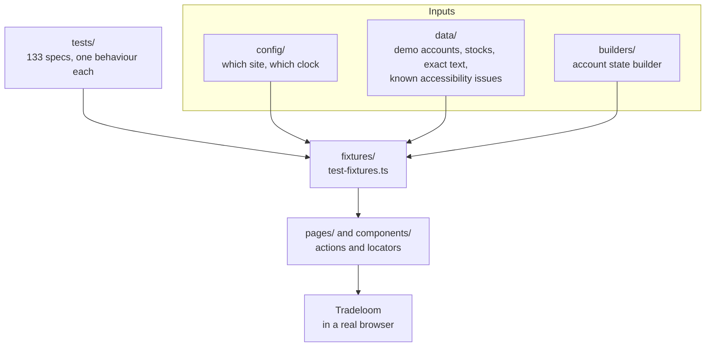
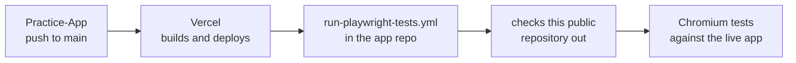

# Tradeloom test framework

[](https://github.com/Yusuf-Hridoy/Playwright-Project/actions/workflows/checks.yml)
[](https://github.com/Yusuf-Hridoy/Playwright-Project/actions/workflows/nightly.yml)

End-to-end tests for **Tradeloom**, a practice stock trading app, written with
Playwright and TypeScript.

The app under test is live at <https://practiceapp-six.vercel.app>. It uses
practice money only. Nothing here touches a real account.

There are **133 tests**. 114 of them are the everyday suite: logging in,
sessions, the market, buying, selling, the portfolio, the wallet, card
payments, receipts, the history filters and its pages, the watchlist, price
alerts and the profile page, the news box and the News page, the chart's hover
point, going offline and the idle log out, plus network failures,
accessibility, how three pages look, and the app on a phone.

The other 19 are about the suite itself rather than the app: they switch the
app's own bugs on to prove the everyday tests would catch them, rename and
move the whole interface to prove the important journeys still pass, and make
the app slow and unreliable to prove the tests wait properly. See
[Resilience](#resilience).

The full run goes out every night and the merged report is published at
<https://yusuf-hridoy.github.io/Playwright-Project/>.

## At a glance

- **133 tests**, plus the log in setup and the agents' seed
- **10 projects**: `setup`, `chromium`, `firefox`, `webkit`, `mobile`,
  `bug-hunt`, `drift`, `resilience`, `seed`, `quarantine`
- **50 of 50 requirements covered** — see
  [the coverage table](docs/requirements-coverage.md)
- **Bugs caught: 5 of 5** in the bug hunt
- The app under test: <https://practiceapp-six.vercel.app>
- The nightly report: <https://yusuf-hridoy.github.io/Playwright-Project/>
- The last 30 nights: <https://yusuf-hridoy.github.io/Playwright-Project/history.html>
- How to work on this repo: [CONTRIBUTING.md](CONTRIBUTING.md)
- The same rules for an AI coding agent: [AGENTS.md](AGENTS.md)

## How the parts fit together



A test asks a page object to do something. The page object clicks and types.
Only the test decides whether the result is right: page objects and components
never assert.

## Run it in five minutes

```powershell
npm ci
npx playwright install chromium firefox webkit
npm test
```

| Command                      | What it does                                     |
| ---------------------------- | ------------------------------------------------ |
| `npm test`                   | Every test, in every project                     |
| `npm run test:smoke`         | The smoke tests, in all three browsers           |
| `npm run test:regression`    | Every tagged test                                |
| `npm run test:a11y`          | The 9 accessibility checks                       |
| `npm run test:visual`        | The 3 screenshot checks, in Chromium             |
| `npm run test:mobile`        | The 3 phone tests, on a Pixel 7                  |
| `npm run test:cross-browser` | The smoke tests in Firefox and WebKit only       |
| `npm run test:bug-hunt`      | The 5 bug-hunt tests, and the score at the end   |
| `npm run test:drift`         | The 9 self-healing tests, and the heal report    |
| `npm run test:resilience`    | The 5 slow and flaky tests                       |
| `npm run test:quarantine`    | Whatever is parked in quarantine right now       |
| `npm run update-snapshots`   | Writes new screenshot baselines for this machine |
| `npm run test:headed`        | The same, with a browser you can watch           |
| `npm run report`             | Opens the HTML report of the last run            |
| `npm run typecheck`          | TypeScript only, no browser                      |

### Against a copy on your laptop

Serve the app yourself, then point the suite at it:

```powershell
# in one terminal, inside your copy of the app
python -m http.server 8000

# in another terminal, here
$env:TEST_ENV = "local"; npm test
```

The local server is a small one, so the suite runs it with 2 workers. Against
the live app it uses every core your machine has.

### Against any other link

```powershell
$env:BASE_URL = "https://my-preview-deploy.vercel.app"; npm test
```

`BASE_URL` wins over `TEST_ENV`. Copy `.env.example` to `.env` to keep a choice
without typing it every time. Every run prints the site it is testing on its
first line.

## The projects

| Project      | Device          | What it runs                                              |
| ------------ | --------------- | --------------------------------------------------------- |
| `setup`      | Desktop Chrome  | Logs in as all three demo accounts and saves the sessions |
| `chromium`   | Desktop Chrome  | Every test except `@mobile`                               |
| `firefox`    | Desktop Firefox | `@smoke` only                                             |
| `webkit`     | Desktop Safari  | `@smoke` only                                             |
| `mobile`     | Pixel 7         | `@mobile` only                                            |
| `bug-hunt`   | Desktop Chrome  | `@bug-hunt` only: the app's own bugs, switched on         |
| `drift`      | Desktop Chrome  | `@drift` only: the app renamed, re-idded and moved        |
| `resilience` | Desktop Chrome  | `@resilience` only: a slow app and a flaky one            |
| `quarantine` | Desktop Chrome  | `@quarantine` only, with no retries                       |

`chromium` leaves out `@mobile`, `@bug-hunt`, `@drift`, `@resilience` and
`@quarantine`, so each of those areas runs in the one project built for it and
nowhere else.

Every project depends on `setup`, and every project shares the same locale,
time zone, base URL and test id attribute. Only the device changes.

Firefox and WebKit run the main journeys, not the whole suite three times over.
A difference between browsers usually shows up in a journey, and a suite that
takes three times as long gets run three times less often.

## Tags

| Tag           | What it marks                                             |
| ------------- | --------------------------------------------------------- |
| `@smoke`      | The main journeys. Also run in Firefox and WebKit         |
| `@regression` | Every test carries this one                               |
| `@a11y`       | An axe-core pass over one page                            |
| `@visual`     | A screenshot compared against a baseline                  |
| `@network`    | A test that holds back, breaks or rewrites a request      |
| `@mobile`     | A phone test, run only in the `mobile` project            |
| `@bug-hunt`   | One of the app's bugs, switched on against a shared check |
| `@drift`      | A journey run against a renamed, re-idded, moved app      |
| `@resilience` | A slow app, or one that drops the odd request             |
| `@quarantine` | Parked: it runs, but it cannot turn the main run red      |

Two more tags are on every test, and `npm run check:tags` fails the build when
one is missing:

| Tag                 | What it marks                                                                                                                   |
| ------------------- | ------------------------------------------------------------------------------------------------------------------------------- |
| `@p1`, `@p2`, `@p3` | The priority. Exactly one per test. `@p1` is the money: log in, the session guard, buying, selling, adding money, card payments |
| `@REQ-AREA-NN`      | The requirement from [docs/requirements.md](docs/requirements.md) that the test protects. At least one, more if it covers more  |

The log in setup carries every tag, all three priorities included, because each
project depends on it and it has to survive whichever filter is used. It is the
one test with no requirement tag.

## What is in each folder

| Folder               | What lives there                                                                                                                                                      |
| -------------------- | --------------------------------------------------------------------------------------------------------------------------------------------------------------------- |
| `config/`            | Which site to test, and the seed, clock, locale and time zone                                                                                                         |
| `data/`              | The demo accounts, the 8 stocks, every message a test checks, the renamed labels, the flaky seeds and the known accessibility issues                                  |
| `builders/`          | The account state builder, which writes an exact account into storage                                                                                                 |
| `fixtures/`          | The `test` object every spec imports                                                                                                                                  |
| `pages/`             | One page object per page of the app                                                                                                                                   |
| `components/`        | Parts that show up on more than one page: menu, rows, dialogs, pop-ups, the card payment frame, the news box, the chart hover, the offline banner and the idle dialog |
| `setup/`             | Logs in once per demo account and saves the session to `.auth/`                                                                                                       |
| `test-files/`        | The one small photo the profile tests upload                                                                                                                          |
| `tests/`             | The specs, grouped by feature                                                                                                                                         |
| `checks/`            | Checks shared by an everyday test and its bug-hunt twin                                                                                                               |
| `reporters/`         | The bug-hunt score, the heal report and the flaky list                                                                                                                |
| `utils/`             | Money formatting, page paths, the frozen clock, backup locators, the accessibility scan and a couple of measurements                                                  |
| `docs/`              | The requirement list, and the coverage table a script writes from it                                                                                                  |
| `scripts/`           | The tag check, the coverage table and the nightly history, as plain Node                                                                                              |
| `ai/`                | The AI triage and heal-suggestion steps, and the prompts they send                                                                                                    |
| `specs/`             | Test plans, written with the Playwright planner agent                                                                                                                 |
| `exploratory-notes/` | Notes from exploratory sessions. Notes only, never code                                                                                                               |
| `.github/`           | The three CI workflows, Dependabot, the pull request template and the issue forms                                                                                     |

## How the test data works

**Three demo accounts**, copied from the app's own demo data into
`data/demo-accounts.ts`:

- **Trader** — $8,808.40 in cash, owns 20 LUMA and 5 KRYL, watches four stocks,
  and has a filled-in profile.
- **Newbie** — $10,000 in cash, owns nothing, watches nothing.
- **Busy** — seven holdings and 24 rows of history.

**Saved logins.** A setup project logs in once as each account and saves the
session. A spec starts already logged in:

```ts
test.use({ storageState: TRADER.storageState });
```

**The state builder** is the fast way to set up anything else. It writes the
account, the watchlist and the profile straight into browser storage before the
page loads, instead of clicking through trades:

```ts
await accountState
  .forUser(TRADER)
  .withCash(50_000) // cents, so $500.00
  .withHolding('KRYL', { shares: 10, totalPaidCents: 140_000 })
  .withWatchlist(['NOVA', 'KRYL'])
  .withAlert('NOVA', { direction: 'above', priceCents: 5_500 })
  .withProfile({ displayName: 'Mira Khan', theme: 'light' })
  .apply();

await marketPage.goto();
await accountState.expectApplied();
```

The app checks the shape of everything it reads and quietly falls back to the
demo data when something does not fit. That failure is silent, so every test
that builds state calls `expectApplied()` once the page is open. It compares the
cash in the top menu with the cash the builder asked for, and fails with a plain
message when the app has thrown the state away.

### `test-files/`

One file is committed: `small-photo.png`, a 24×24 PNG of about 100 bytes. It is
the good photo the profile tests upload.

The other two files a test needs are built inside the test, with
`setInputFiles({ name, mimeType, buffer })`: a 1.1 MB buffer for the "too big"
rule, and a text file for the "wrong type" rule. Keeping a megabyte of junk out
of the repository is half the reason; the other half is that the test then says,
in the test itself, exactly what makes the file wrong.

## Paying by card

Adding money opens a card form inside an iframe. `components/payment-frame.ts`
wraps it, and `WalletPage.addMoney('$5,000')` picks the amount, presses Add and
pays with the test card that always work:

```ts
await walletPage.addMoney('$5,000');
```

Pressing Pay starts a two second "Processing…" timer inside the frame. The
clock is frozen, so nothing moves on its own. That gives a test two ways in:

```ts
await walletPage.paymentFrame.pay(); // press Pay and stop there
await expect(walletPage.paymentFrame.processingButton).toBeVisible();
await walletPage.paymentFrame.finishProcessing(); // let the two seconds pass
```

`payWith(cardNumber)` does both for tests that only want the result. Each field
can be filled on its own with `fillField`, and each field's own message is read
with `fieldError`. The three test cards, and one the app has never heard of,
are exported from the same file.

A paid top-up leaves a history row, and every history row has a receipt behind
it. `WalletPage.openReceipt(rowIndex)` clicks the row's Open link and hands
back the tab it opened in, which `pages/receipt-page.ts` then reads:

```ts
const tab = await walletPage.openReceipt(0);
const receipt = new ReceiptPage(tab);
await receipt.waitUntilReady();
expect(await receipt.rowAmountCents('total')).toBe(70_360);
```

## News, the chart, offline and the idle log out

Eighteen tests cover the four newest parts of the app. Each one leans on a
different piece of Playwright.

**The news box** (`tests/news/news-box.spec.ts`, 3 tests) is a custom element
that draws itself inside an **open shadow root**. `getByTestId` and `getByRole`
walk through an open boundary on their own, so the tests read like any other;
one of them proves the boundary is really there by asking the element whether
its `shadowRoot` exists. The box also remembers being hidden across a reload,
and a headline in it opens that same headline on the News page, already open,
scrolled to and focused.

**The News page** (`tests/news/news-page.spec.ts`, 7 tests) loads ten headlines
at a time as you scroll. The app watches a marker under the list with an
`IntersectionObserver` and waits one second with `setTimeout` before the next
ten arrive, so the tests scroll, wait for the "Loading more news…" line and then
move the clock:

```ts
await newsPage.scrollToEnd();
await expect(newsPage.loadingLine).toBeVisible();
await page.clock.runFor(1_000);
await expect(newsPage.items).toHaveCount(20);
```

They walk that loop until all 60 are on the page, and they check that the first
headline is still **the same element** afterwards, not a rebuilt copy of itself,
by keeping its handle and asking whether it is still connected. The rest cover
the per-stock filter and the `?stock=` it writes into the address bar, Back,
"Read more", "Back to top" and where it leaves the focus, and the fact that the
same seed at the same frozen moment gives the same ten headlines while another
seed shuffles them.

**The chart's hover point** (`tests/chart/chart-hover.spec.ts`, 3 tests) is
driven with **real mouse moves**: `hoverAt(0.5)` reads the chart's bounding box
and moves the pointer to that share of its width. The keyboard gets the same
point with Home, End and the arrow keys, and every keyboard move is read back
out of the hidden status line the app keeps for screen readers. The third test
is a guard on a bug the app has already fixed: every test starts at exactly
10:00, which is exactly on a five minute mark, and the chart used to put its
newest point on twice, so End read 10:00 and the left arrow read 10:00 again
instead of 09:55.

**Offline** (`tests/offline/offline.spec.ts`, 2 tests) uses
`context.setOffline(true)`, which is what makes the app's own `online` and
`offline` listeners fire. The banner shows, a buy is refused with the exact
offline message, and coming back puts up a "You're back online." pop-up that
closes itself three seconds later on the clock.

**The idle log out** (`tests/idle/idle-logout.spec.ts`, 2 tests) is the one
place where **doing nothing is the test**. Every click, key press, wheel turn
and scroll resets the app's timer, so once the page is open these two touch
nothing but `page.clock.runFor()`. At fourteen minutes the warning comes up and
counts the last minute down; "Stay logged in" closes it and starts the fourteen
minutes again. At fifteen the session goes, the log in page explains why, and
logging back in finds the same cash. They sit on the Rules page, which has no
price refresh of its own, so moving the clock a quarter of an hour stays cheap.

## Resilience

Four questions about the suite itself, rather than about the app.

### Bug hunt

**What it proves.** A test that still passes against a broken app is worse
than no test, because it reads as proof that the app is fine. The app has five
bugs that can be switched on from the link (`?bug=cost`), and each one has a
test here that runs the very check the everyday suite runs, with that bug on.

Each check lives in `checks/`, and both tests call it: the everyday test on a
healthy app, the bug-hunt test on a broken one. That is what makes the result
mean something. A check written only for the bug hunt would prove nothing
about the tests that run every day.

| Bug      | What the app gets wrong                                      | The shared check, and the everyday test that calls it                                                  |
| -------- | ------------------------------------------------------------ | ------------------------------------------------------------------------------------------------------ |
| `cost`   | From two shares up, the total charges for one share too many | `expectBuyTotalIsRight` — _buying 5 KRYL takes the same cash in the summary, the message and the menu_ |
| `gain`   | Every gain is shown with the sign turned round               | `expectEachGainIsRight` — _total worth is the cash plus every holding at today price_                  |
| `limit`  | Top-ups run on to $60,000 while the note still says $50,000  | `expectTopUpsStopAtTheLimit` — _top-ups stop once the account has added $50,000 in all_                |
| `sort`   | "Sort by gain" puts the smallest gain first                  | `expectSortByGainPutsTheBiggestFirst` — _"Sort by gain" puts the biggest gain at the top_              |
| `search` | The search box insists on the exact letter case              | `expectSearchFindsOnly` — _searching for "robot" leaves only Kryl Robotics_                            |

**How to run it.** `npm run test:bug-hunt`.

**How to read the score.** Every bug-hunt test is marked `test.fail()`, so
Playwright reads it the other way round from every other test here:

- **green** — the check failed, so the bug was caught. That is the good result.
- **red**, with _"expected to fail, but passed"_ — the bug slipped through.
  The everyday test that shares that check has stopped checking what its name
  says it checks.

At the end of the run one line sums it up, and on CI the same line goes into
the job summary:

```
Bugs caught: 5 of 5
```

Anything less than 5, and the bugs that got through are named.

### Self-healing

**What it proves.** Interfaces get renamed. A button that said "Log in" last
month says "Sign in" today, the test ids all change at once, the layout moves,
and a cookie banner appears over the lot. The journeys that matter should keep
working, and somebody should be told which locators are now living in the past.

**How backup locators work.** A page object hands `healing()` an ordered list
of ways to find one element:

```ts
this.submitButton = healing({
  where: 'LoginPage',
  element: 'submit button',
  ways: [
    {
      how: 'role button named Log in',
      locator: page.getByRole('button', { name: TEXT.login.submit }),
    },
    {
      how: 'role button named log in or sign in',
      locator: page.getByRole('button', { name: LOG_IN }),
    },
  ],
});
```

The first way is always today's normal locator, so a normal run behaves exactly
as it did before. When it finds nothing, the helper waits for any of the ways,
works out which one actually matched, and notes it against the running test.
What it hands back is an ordinary `Locator`: tests and page objects use it
with `expect()` and `click()` as usual.

The renamed wording lives in one place, `data/label-synonyms.ts` — the list a
team keeps when the product changes its mind about a word.

**Which elements have backups.** Only the critical path: the log in fields, the
top menu, the market search and its rows, the trade box from the shares field
to the success message, the holdings rows, and the whole top-up through the
card frame. Plus the handful of elements each page waits on to call itself
ready, because a page object that cannot tell the page has loaded never gets
as far as the interesting part.

**The popups.** With `drift=popup` the app shows a cookie banner and a "Try
Tradeloom Pro" dialog. `fixtures/popup-handlers.ts` registers two
`addLocatorHandler` handlers that close them, and only for the `drift` project.
In every other project a popup that turns up on its own should fail the test it
interrupted, because that would mean the app really changed.

**How to read the heal report.** `npm run test:drift` writes
`heal-report/heal-report.md` (and `.json` for tools):

| Page object | Element       | What failed              | What worked                         | Tests |
| ----------- | ------------- | ------------------------ | ----------------------------------- | ----- |
| LoginPage   | submit button | role button named Log in | role button named log in or sign in | 2     |

Every row is a locator to update. Healing is a warning, never a fix: the suite
keeps running so the night is not wasted, and the row says what to put right in
the morning.

**Why a heal in a normal run matters.** In the `drift` project a heal is the
exercise working. Anywhere else it means the real app has moved and nobody
noticed, so the report puts a line at the top:

> Healing happened in a normal run. The app may have changed: check these
> locators.

### Slow and flaky

**What the tests show.** With `slow=3000` every data load in the app waits
three seconds, and the loads are one after another, not all at once. Three
tests show the Market page working through its loading state to all eight
stocks, a buy going through from end to end, and the Portfolio filling in. Two
more turn on `flaky=on` with a seed where the stock list is certain to fail the
first time: the error box shows, "Try again" brings the stocks back, and a
second page opened from scratch does exactly the same thing in the same order.

**How `advanceUntil` works.** The clock is frozen for every test here, so a
three second wait in the app never ends on its own. One big
`page.clock.runFor(10_000)` does not work either: the second load is only
started once the first has finished, so the clock runs past a timer that has
not been made yet. `advanceUntil(page, locator)` moves the clock half a second
at a time and looks at the page after each step, until the locator is on screen
or 30 seconds of the app's own time have gone by, and then says so clearly.

Each look is a short ordinary wait on the locator rather than a glance, because
the app's slow switch is a timer in front of a real request: moving the clock
starts the request, and the answer still has to travel the real internet.

The seed for the flaky tests is in `data/resilience-seeds.ts`, with a note on
how it was found and how to find another if the app's rule changes.

### Quarantine

**What it is for.** One test that fails every other night teaches a team to
ignore red runs, and then a real failure goes unnoticed too. A quarantined test
still runs and is still reported, but its result cannot turn the main run red.

**How to quarantine a test.** Add the tag:

```ts
test('the thing that keeps falling over', { tag: ['@quarantine'] }, async ({ marketPage }) => {
```

That one word moves it out of `chromium`, `firefox`, `webkit` and `mobile`, and
into the `quarantine` project, which runs with `retries: 0` — a retry would
only hide how unsteady the test is, which is the one thing quarantine exists to
show. In the nightly the shards skip it and a separate job runs
`npm run test:quarantine` with `continue-on-error: true`.

**How to release it.** Fix the test, delete the `@quarantine` tag, and it goes
straight back into the everyday projects. Nothing else to undo.

**Nothing is quarantined today.** The `quarantine` project runs the log in
setup and nothing else.

**The flaky list.** A test that fails and then passes on a retry is the most
expensive kind to ignore: the run goes green and nobody looks.
`reporters/flaky-reporter.ts` collects them at the end of every run and writes
`flaky-report/flaky-report.md` with the test, the file, the project and how
many goes it took. On CI the same list goes into the job summary, or the line
`No flaky tests in this run.` Both report folders are in `.gitignore` and are
uploaded as artifacts by the nightly.

## Accessibility checks

`npm run test:a11y` runs one axe-core pass per page: log in, Market, Stock,
Portfolio, Wallet, Watchlist, News, Profile and Rules.

- The rules used are WCAG 2.1, levels A and AA (`wcag2a`, `wcag2aa`, `wcag21a`,
  `wcag21aa`).
- A page **fails on any serious or critical problem**. Smaller problems are
  printed in the failure text but do not fail a test on their own.
- A failure prints each problem's rule id, how bad it is, axe's own description
  and every element it was found on, so the report can be read without opening
  a trace.
- Axe leans on its own timers, so each of these tests lets the frozen clock go
  with `page.clock.resume()` before scanning.

**Known issues live in `data/a11y-known-issues.ts`.** A rule is listed there
only when the app is really wrong, with the page, the rule id and one sentence
saying why, and it is then skipped on that one page and nowhere else. Every
entry is a bug to fix in the app, not a test that was made to pass.

**The list is empty today**, so every rule is checked on every page. The two
problems that used to sit there were both fixed in the app:

| Page                 | Rule                          | What the app used to do, and what it does now                                                                                                                                                                              |
| -------------------- | ----------------------------- | -------------------------------------------------------------------------------------------------------------------------------------------------------------------------------------------------------------------------- |
| log in               | `link-in-text-block`          | The "How it works" link inside the footer was told apart from the words around it by colour alone. Links are underlined now, in both themes.                                                                               |
| every signed-in page | `label-content-name-mismatch` | The profile circle showed the initials "TR" while its `aria-label` was only "Your profile". The label now starts with the visible text ("TR, your profile"), or with the display name when a photo leaves no visible text. |

## Visual checks

`npm run test:visual` compares three pages against a picture of themselves: the
log in page, the Market page as the Trader sees it, and the Rules page. Each one
is a full-page shot with animations turned off and a one per cent allowance for
odd pixels.

```ts
await expect(page).toHaveScreenshot('market-page.png', {
  fullPage: true,
  animations: 'disabled',
  maxDiffPixelRatio: 0.01,
});
```

These run in Chromium only. Nothing on those pages moves: the clock is frozen,
the seed is 42 and the account is fixed.

**Screenshots are kept per operating system.** The same page drawn with Windows
fonts, Mac fonts and Linux fonts is never pixel for pixel the same, so Playwright
saves each baseline with the platform in its name, like
`market-page-chromium-win32.png`.

The Windows baselines are made on a laptop with `npm run update-snapshots`. The
Linux ones the nightly run needs are made by the **update-linux-screenshots**
workflow, started by hand from the Actions tab; it commits only the
`-linux.png` files. Until that has been run once, the visual tests fail on CI
with "missing snapshot", which is expected rather than a problem with the app.

After a change to the app you meant to make:

```powershell
npm run update-snapshots
```

Then look at the new pictures before keeping them. A baseline updated without
looking is a check that has stopped checking.

## AI in this framework

Phase 7 added four AI parts. Every one of them suggests; a person decides.

### What each part does

| Part                                      | What it does                                                                                                                     |
| ----------------------------------------- | -------------------------------------------------------------------------------------------------------------------------------- |
| [AGENTS.md](AGENTS.md)                    | The rules of this repo, written for an AI coding tool. `CLAUDE.md` is one line, `@AGENTS.md`, which is how Claude Code finds it. |
| [Playwright MCP](.mcp.json)               | A real browser an agent can drive, for exploratory sessions. See [the guide](docs/exploratory-testing-guide.md).                 |
| [Playwright test agents](.claude/agents/) | A planner, a generator and a healer. They wrote the plans in `specs/` and the first drafts of the last three tests.              |
| `npm run ai:triage`                       | Reads the night's failures and says what kind of problem each one looks like.                                                    |
| `npm run ai:heal`                         | Reads the heal report and suggests a better locator for each element a test had to heal around.                                  |

### What a person still decides

Everything that changes a file. The AI writes two reports and stops:

- **Triage** says "this looks like an app bug". You open the app, or the trace,
  and find out. The table in
  [How to read the AI output](#how-to-read-the-ai-output) says what to do with
  each answer.
- **Heal suggestions** come with the old locator, the new one, and whether the
  new one was checked on the real page. Pasting it into the page object is a
  person's job, in a pull request, like any other change.

Nothing is ever filed, messaged or committed on your behalf.

### The safety rules

- **No code written by an AI is run.** A heal suggestion is a description —
  `{ strategy: 'role', role: 'button', name: 'Log in' }` — and
  `ai/suggest-heals.mjs` builds the Playwright locator itself, from four
  strategies and nothing else.
- **Every answer is checked for shape first.** `ai/check-shape.mjs` rejects an
  answer with a field it does not know, a category that is not on the list, or
  a strategy it cannot build. A rejected answer is shown as unusable, never
  patched up.
- **Every heal suggestion is verified on the page.** The script reopens the
  same page, with the same drift and the same saved login, and the suggestion
  is only marked `verified` when the built locator finds exactly one element
  and it is the same element the backup locator found.
- **Nothing private leaves the machine.** `ai/redact.mjs` strips keys, tokens,
  JWTs and embedded files from every string before it is sent, and cuts each
  error to 1,500 characters and each step list to the last 10 steps.
- **An AI step can never fail a run, or message anyone, or open an issue.**
  Both run with `continue-on-error`, and both exit successfully with one clear
  note when there is no key or the provider is down.
- **No AI SDK packages.** Both providers are called with plain `fetch`, from
  `ai/ai-client.mjs`, so what is sent and where is all in one readable file.

### Switching provider

Three environment variables, and nothing else:

| Name                             | Meaning                                                                 |
| -------------------------------- | ----------------------------------------------------------------------- |
| `AI_PROVIDER`                    | `groq` or `gemini`. Missing or anything else: the AI steps are skipped. |
| `AI_MODEL`                       | Optional. Overrides the default model for that provider.                |
| `GROQ_API_KEY`, `GEMINI_API_KEY` | The key for the provider you chose.                                     |

On CI, `AI_PROVIDER` and `AI_MODEL` come from repository **variables** and the
two keys from repository **secrets**. On a laptop they go in `.env`, which is
never committed. The default model for each provider, and why it was chosen, is
written down in one place at the top of `ai/ai-client.mjs`.

```bash
# on a laptop, after a drift run
npm run test:drift
AI_PROVIDER=groq GROQ_API_KEY=... npm run ai:heal
```

### How to read the AI output

| You see                               | What it means                                   | What you do                                                |
| ------------------------------------- | ----------------------------------------------- | ---------------------------------------------------------- |
| Triage: app bug, high confidence      | The app likely broke                            | Check that part of the app by hand first                   |
| Triage: test bug                      | The test likely needs fixing, not the app       | Open the test and the trace                                |
| Triage: flaky                         | Random timing                                   | Watch it a few nights. If it repeats, tag it `@quarantine` |
| Triage: environment                   | The site or the network was down                | Usually nothing. Re-run later                              |
| Triage: AI couldn't classify this one | The answer was not usable                       | Read the error yourself, as before                         |
| Heal: verified                        | The new locator finds exactly the right element | Copy it into the page object, as the new first way         |
| Heal: not verified                    | The suggestion did not check out                | Ignore it, or fix the locator yourself                     |
| AI ... skipped: no key                | `AI_PROVIDER` or the key is missing             | Set them, or leave them: the run is green either way       |

### Where it runs

- **The nightly**, in the merge job, after the reports are merged: triage over
  the merged results file, then heal suggestions. `ai-report/` goes up as an
  artifact, and both tables are added to the run's summary page.
- **After each deploy of the app**, from the app's own workflow, which runs
  `npm run ai:heal` against the live site. A heal there means the app really
  changed under the tests, which is exactly when a suggestion is worth having.
- **On a laptop**, with `BASE_URL` and whatever heal report your last run left
  behind.

### Reading further

- [AGENTS.md](AGENTS.md) — the rules, for an agent
- [docs/ai-agents-walkthrough.md](docs/ai-agents-walkthrough.md) — how the test
  agents were actually used here, honestly, with the prompts
- [docs/exploratory-testing-guide.md](docs/exploratory-testing-guide.md) — the
  three ready exploratory missions

## Continuous integration

Three workflows live in `.github/workflows/`. Every job that runs a test runs
inside Playwright's own Docker image, at the version in `package.json`, so the
browsers are already there and no job installs one. Each workflow is given the
smallest set of permissions that lets it do its job. Whenever tests fail, the
HTML report is kept as an artifact for 14 days.

| Workflow                       | When it runs                              | What it does                                                                                                                                                                             |
| ------------------------------ | ----------------------------------------- | ---------------------------------------------------------------------------------------------------------------------------------------------------------------------------------------- |
| `checks.yml`                   | every push to `main`, every pull request  | `npm run lint`, `npm run format:check`, the tag check, `npm run typecheck`, then the `@smoke` tests on Chromium against the live app                                                     |
| `nightly.yml`                  | 20:00 UTC daily (02:00 Dhaka), or by hand | the whole suite, every project but `quarantine`, in three shards, merged into one HTML report and published to GitHub Pages; quarantine runs in a job of its own that is allowed to fail |
| `update-linux-screenshots.yml` | by hand only                              | writes the Linux screenshot baselines and commits just the `-linux.png` files                                                                                                            |

**The nightly report is at <https://yusuf-hridoy.github.io/Playwright-Project/>.**
It is replaced by each nightly run, so it always shows the most recent full
pass over every browser.

### How a deploy runs the tests



The app repository runs these tests itself. Nothing is sent between the two
repositories, and no token is involved: this repository is public, so the app's
workflow can simply check it out and run it in place.

1. The app is pushed, and Vercel builds and deploys it.
2. Vercel posts a `deployment_status` event. `run-playwright-tests.yml`, in the
   app repository, picks up the successful **Production** ones and leaves
   preview builds alone.
3. That workflow checks this repository out beside the app, installs it with
   `npm ci`, and runs every Chromium test except the visual ones.
4. It points them at the stable production link rather than the deployment's
   own URL, because Vercel can put protection in front of a per-deployment URL
   and the tests have to be able to open it.
5. The result shows on the app's own commit, as that workflow's run, and the
   HTML report is kept as an artifact when something failed. A newer deploy
   cancels a run that is still going.

The same run can be started by hand from the app repository's Actions tab.

### What CI changes about a run

`playwright.config.ts` reads `process.env.CI` and nothing else: two retries, two
workers, and `forbidOnly` so a stray `test.only` cannot quietly shrink the
suite. Everything else is the same as on a laptop.

## How this repo is run

### The code checks, and what happens when you commit

ESLint runs the recommended TypeScript rules **with type information**, which
is what makes `@typescript-eslint/no-floating-promises` work: it is the rule
that catches a missing `await` in front of an `expect` or a page action.
Alongside it, `eslint-plugin-playwright` runs on every file that drives a
browser, and seven of its rules are errors on purpose — a missing await,
`waitForTimeout`, `test.only`, `test.skip`, `{ force: true }`, `page.pause()`,
and an assertion that is not web-first. Prettier settles the formatting, and
`eslint-config-prettier` comes last so the two never argue.

```bash
npm run lint           # ESLint over everything
npm run format         # Prettier, writing
npm run format:check   # Prettier, only telling you
npm run typecheck      # tsc --noEmit
```

A Git hook runs before every commit. It runs `lint-staged`, which runs
`eslint --fix` and then `prettier --write` over **the staged files only**, and
puts the fixed versions back into the commit. If ESLint still finds an error
after its own `--fix`, the commit stops. `npm ci` installs the hook; CI skips
that, because CI makes no commits.

`typescript` is held at 6.x on purpose. typescript-eslint will not load against
the TypeScript 7 API, and the type-aware rules are worth more here than the
newer compiler.

### Why CI runs in Docker, and how the image follows package.json

A test that passes on a laptop and fails on CI usually fails because the two
machines are not the same machine. Every CI job that runs a test now runs
inside `mcr.microsoft.com/playwright:v<version>-noble`, the image Playwright
publishes with the browsers already installed at the exact version they were
built for.

The version is read in one place. A small first job in each workflow reads
`@playwright/test` out of `package.json` and prints the image name:

```yaml
version="$(node -p "require('./package.json').devDependencies['@playwright/test']")"
echo "image=mcr.microsoft.com/playwright:v${version}-noble" >> "$GITHUB_OUTPUT"
```

Every other job takes it with `needs: version` and
`container: { image: ${{ needs.version.outputs.image }} }`. A Dependabot bump
of `@playwright/test` therefore moves the image as well, with nothing to keep
in step by hand. The Pages publish job runs no tests, so it stays on the plain
runner.

The screenshots are per image as well as per platform. After the image
changes, run **update-linux-screenshots** once from the Actions tab and pull
the new baselines.

### Requirements, and how to read the coverage table

[`docs/requirements.md`](docs/requirements.md) is 50 rules the app promises,
one short sentence each, taken from the app's own Rules page, its pages and its
test switches. Each has an ID, like `REQ-TRADE-01`.

Every test carries the IDs of the behaviour it protects. A bug-hunt, drift or
resilience test uses the same ID as the everyday test that covers the same
behaviour, so the table shows every angle a requirement is tested from.

[`docs/requirements-coverage.md`](docs/requirements-coverage.md) is written by
a script, not by hand. For each requirement it gives the number of tests and
their names, grouped by area, then a **Not covered yet** list and the total.
Rebuild it after changing a tag or a requirement:

```bash
npm run coverage:requirements
```

Commit the file it writes. A requirement with no test is allowed — it is shown,
not treated as a failure. A test that uses an ID that is not in the list is an
error, and `npm run check:tags` says which test and which ID.

### Priorities, and the two minute run

Every test carries exactly one of `@p1`, `@p2` or `@p3`. `@p1` is the money:
logging in, the session guard, buying, selling, the money math, adding money
and card payments.

```bash
npm run test:critical   # the @p1 tests on Chromium, about half a minute
```

That is the run to make before pushing anything that touches money. The full
run still belongs to the night.

### The history page

The nightly run keeps the last 30 nights at
<https://yusuf-hridoy.github.io/Playwright-Project/history.html>, beside the
report. It shows passed, failed and flaky over the nights, a table of every
night, and tonight's ten slowest tests. The same numbers go into the job
summary of the run that produced them.

It works by writing `history.json` next to the report. Each night fetches last
night's copy from the published page, adds tonight, trims to 30 and publishes
both again. The first night has nothing to fetch, which is fine.

### Dependency updates

Dependabot opens pull requests every Monday morning, Dhaka time, at most five
at a time, for both npm and the GitHub Actions. `@playwright/test` and
`@axe-core/playwright` are grouped, because they share `playwright-core` and
moving one without the other leaves two copies of it. The lint and format tools
are grouped as `code-quality`.

Every one of those pull requests runs `checks.yml`, so an update is linted,
formatted, tag-checked, typechecked and smoke-tested before anyone merges it.
A Playwright bump also moves the Docker image, so read the smoke run before
merging it, and take the Linux screenshots again afterwards.

### Where to look next

- [CONTRIBUTING.md](CONTRIBUTING.md) — how to add a test the way the rest are
  written, the tagging rules, and what to do with a flaky test
- [Flaky test issue form](.github/ISSUE_TEMPLATE/flaky-test.yml)
- [New test issue form](.github/ISSUE_TEMPLATE/new-test.yml)

## Network checks

Four tests take the app's one request for its stock list,
`**/data/stocks.json`, and do something unkind to it:

- abort it, so the Market page shows "Couldn't load prices", then remove the
  route and press Try again,
- hold it until the test lets it go, so the three grey loading rows can be seen
  before the real ones (a promise the test resolves, never a timer),
- answer it with a list of two stocks, so the page shows exactly two rows,
- abort it on a Stock page, which shows the same load error.

## The app on a phone

Three tests run in the `mobile` project only, on a Pixel 7: logging in and
buying works at phone size, none of the seven signed-in pages scrolls sideways,
and the alert editor sits under the watchlist instead of beside it.

## Why the results are the same on every machine

- **A fixed seed.** Every page is opened with `?seed=42`, so the app's made-up
  prices repeat exactly.
- **A frozen clock.** Every test starts at Monday 9 November 2026, 10:00 Dhaka
  time, and time stands still until a test moves it with
  `page.clock.runFor(...)`.
- **One time zone.** `Asia/Dhaka`, the zone the app does all its own date
  arithmetic in.
- **One money format.** `en-US` dollars, built with the same
  `Intl.NumberFormat` the app uses, so `$8,808.40` is never typed by hand.

Expected numbers come from the demo data, the state builder, or the
`data-cents` attribute the app puts on every money value. No test guesses a
price.

### The market is open all day now

Market hours are gone. The market is open every hour of every day, and the only
thing that shuts it is `?market=closed` on the link. A test that wants it shut
says so, and every page its page objects open carries the switch:

```ts
test.use({ marketClosed: true });
```

## Tags and naming

- Tests are tagged with Playwright's `tag` option. Smoke tests carry both
  `@smoke` and `@regression`; every other test carries `@regression` and
  whichever of `@a11y`, `@visual`, `@network` and `@mobile` fits.
- A test name reads like a sentence about the app, for example _buying 5 KRYL
  takes the same cash in the summary, the message and the menu_.
- One behaviour per test. Each one arranges, acts, then asserts, with a blank
  line between. Longer flows are split with `test.step`.
- Every test sets up its own account, so they run alone, in any order and in
  parallel.

## Rules the code follows

- Buttons, links and fields are found with `getByRole` and `getByLabel`.
  App data is found with `getByTestId`, or by the `data-` attribute the app
  marks it with. No class selectors and no XPath.
- Waiting is done with web-first assertions only. There is no
  `waitForTimeout` anywhere; the clock moves with Playwright's Clock API.
- Nothing imports the app's own source at run time. What the tests need is
  copied into `data/`.

## What is next

- The app's test switches, its API and the bugs and drift they turn up.
- API-level tests.

---

The old Swag Labs suite that used to live in this repository is kept under the
git tag `swag-labs-v1`.
