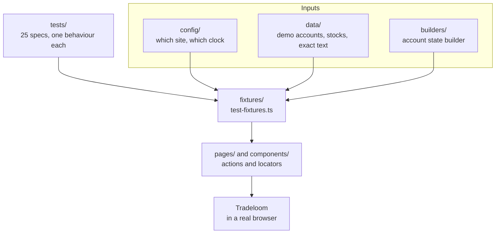

# Tradeloom test framework

End-to-end tests for **Tradeloom**, a practice stock trading app, written with
Playwright and TypeScript.

The app under test is live at <https://practiceapp-six.vercel.app>. It uses
practice money only. Nothing here touches a real account.

There are 25 tests. They cover logging in, sessions, the market, buying,
selling, the portfolio, the wallet, the watchlist and price alerts.

## How the parts fit together



A test asks a page object to do something. The page object clicks and types.
Only the test decides whether the result is right: page objects and components
never assert.

## Run it in five minutes

```powershell
npm ci
npx playwright install chromium
npm test
```

| Command | What it does |
| --- | --- |
| `npm test` | Every test against the live app |
| `npm run test:smoke` | The 6 smoke tests, plus the log in setup |
| `npm run test:regression` | Every tagged test |
| `npm run test:headed` | The same, with a browser you can watch |
| `npm run report` | Opens the HTML report of the last run |
| `npm run typecheck` | TypeScript only, no browser |

### Against a copy on your laptop

Serve the app yourself, then point the suite at it:

```powershell
# in one terminal, inside your copy of the app
python -m http.server 8000

# in another terminal, here
$env:TEST_ENV = "local"; npm test
```

The local server is a small one, so the suite runs it with 2 workers. Against
the live app it uses every core your machine has.

### Against any other link

```powershell
$env:BASE_URL = "https://my-preview-deploy.vercel.app"; npm test
```

`BASE_URL` wins over `TEST_ENV`. Copy `.env.example` to `.env` to keep a choice
without typing it every time. Every run prints the site it is testing on its
first line.

## What is in each folder

| Folder | What lives there |
| --- | --- |
| `config/` | Which site to test, and the seed, clock, locale and time zone |
| `data/` | The demo accounts, the 8 stocks, and every message a test checks |
| `builders/` | The account state builder, which writes an exact account into storage |
| `fixtures/` | The `test` object every spec imports |
| `pages/` | One page object per page of the app |
| `components/` | Parts that show up on more than one page: menu, rows, dialogs, pop-ups |
| `setup/` | Logs in once per demo account and saves the session to `.auth/` |
| `tests/` | The specs, grouped by feature |
| `utils/` | Money formatting and the page path rules |

## How the test data works

**Two demo accounts**, copied from the app's own demo data into
`data/demo-accounts.ts`:

- **Trader** — $8,808.40 in cash, owns 20 LUMA and 5 KRYL, watches four stocks.
- **Newbie** — $10,000 in cash, owns nothing, watches nothing.

**Saved logins.** A setup project logs in once as each account and saves the
session. A spec starts already logged in:

```ts
test.use({ storageState: TRADER.storageState });
```

**The state builder** is the fast way to set up anything else. It writes the
account straight into browser storage before the page loads, instead of
clicking through trades:

```ts
await accountState
  .forUser(TRADER)
  .withCash(50_000)                                          // cents, so $500.00
  .withHolding('KRYL', { shares: 10, totalPaidCents: 140_000 })
  .withWatchlist(['NOVA', 'KRYL'])
  .withAlert('NOVA', { direction: 'above', priceCents: 5_500 })
  .apply();

await marketPage.goto();
await accountState.expectApplied();
```

The app checks the shape of everything it reads and quietly falls back to the
demo data when something does not fit. That failure is silent, so every test
that builds state calls `expectApplied()` once the page is open. It compares the
cash in the top menu with the cash the builder asked for, and fails with a plain
message when the app has thrown the state away.

## Why the results are the same on every machine

- **A fixed seed.** Every page is opened with `?seed=42`, so the app's made-up
  prices repeat exactly.
- **A frozen clock.** Every test starts at Monday 9 November 2026, 10:00 Dhaka
  time, with the market open, and time stands still until a test moves it with
  `page.clock.runFor(...)`. Tests that need the market shut say
  `test.use({ marketTime: MARKET_CLOSED_TIME })`.
- **One time zone.** `Asia/Dhaka`, the zone the app does all its own date
  arithmetic in.
- **One money format.** `en-US` dollars, built with the same
  `Intl.NumberFormat` the app uses, so `$8,808.40` is never typed by hand.

Expected numbers come from the demo data, the state builder, or the
`data-cents` attribute the app puts on every money value. No test guesses a
price.

## Tags and naming

- Tests are tagged with Playwright's `tag` option. Smoke tests carry both
  `@smoke` and `@regression`; everything else carries `@regression`.
- The log in setup carries both tags too, because every project depends on it
  and it has to run under either filter.
- A test name reads like a sentence about the app, for example *buying 5 KRYL
  takes the same cash in the summary, the message and the menu*.
- One behaviour per test. Each one arranges, acts, then asserts, with a blank
  line between. Longer flows are split with `test.step`.
- Every test sets up its own account, so they run alone, in any order and in
  parallel.

## Rules the code follows

- Buttons, links and fields are found with `getByRole` and `getByLabel`.
  App data is found with `getByTestId`, or by the `data-` attribute the app
  marks it with. No class selectors and no XPath.
- Waiting is done with web-first assertions only. There is no
  `waitForTimeout` anywhere; the clock moves with Playwright's Clock API.
- Nothing imports the app's own source at run time. What the tests need is
  copied into `data/`.

## What is next

- More coverage: the profile page, the rules page, keyboard shortcuts and the
  error states behind the retry buttons.
- More browsers: Firefox and WebKit, plus a phone-sized viewport.
- Accessibility checks and visual checks on the pages that matter.
- CI that runs the smoke tests on every deploy and the full suite nightly.

---

The old Swag Labs suite that used to live in this repository is kept under the
git tag `swag-labs-v1`.
