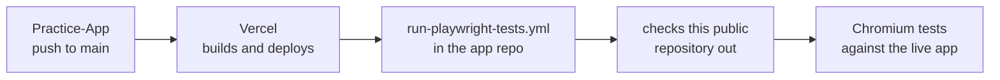

# Tradeloom test framework

[](https://github.com/Yusuf-Hridoy/Playwright-Project/actions/workflows/checks.yml)
[](https://github.com/Yusuf-Hridoy/Playwright-Project/actions/workflows/nightly.yml)

End-to-end tests for **Tradeloom**, a practice stock trading app, written with
Playwright and TypeScript.

The app under test is live at <https://practiceapp-six.vercel.app>. It uses
practice money only. Nothing here touches a real account.

There are **110 tests**. They cover logging in, sessions, the market, buying,
selling, the portfolio, the wallet, card payments, receipts, the history
filters and its pages, the watchlist, price alerts and the profile page, the
news box and the News page, the chart's hover point, going offline and the
idle log out, plus network failures, accessibility, how three pages look, and
the app on a phone.

The full run goes out every night and the merged report is published at
<https://yusuf-hridoy.github.io/Playwright-Project/>.

## How the parts fit together


A test asks a page object to do something. The page object clicks and types.
Only the test decides whether the result is right: page objects and components
never assert.

## Run it in five minutes

```powershell
npm ci
npx playwright install chromium firefox webkit
npm test
```

| Command | What it does |
| --- | --- |
| `npm test` | Every test, in every project |
| `npm run test:smoke` | The smoke tests, in all three browsers |
| `npm run test:regression` | Every tagged test |
| `npm run test:a11y` | The 9 accessibility checks |
| `npm run test:visual` | The 3 screenshot checks, in Chromium |
| `npm run test:mobile` | The 3 phone tests, on a Pixel 7 |
| `npm run test:cross-browser` | The smoke tests in Firefox and WebKit only |
| `npm run update-snapshots` | Writes new screenshot baselines for this machine |
| `npm run test:headed` | The same, with a browser you can watch |
| `npm run report` | Opens the HTML report of the last run |
| `npm run typecheck` | TypeScript only, no browser |

### Against a copy on your laptop

Serve the app yourself, then point the suite at it:

```powershell
# in one terminal, inside your copy of the app
python -m http.server 8000

# in another terminal, here
$env:TEST_ENV = "local"; npm test
```

The local server is a small one, so the suite runs it with 2 workers. Against
the live app it uses every core your machine has.

### Against any other link

```powershell
$env:BASE_URL = "https://my-preview-deploy.vercel.app"; npm test
```

`BASE_URL` wins over `TEST_ENV`. Copy `.env.example` to `.env` to keep a choice
without typing it every time. Every run prints the site it is testing on its
first line.

## The projects

| Project | Device | What it runs |
| --- | --- | --- |
| `setup` | Desktop Chrome | Logs in as all three demo accounts and saves the sessions |
| `chromium` | Desktop Chrome | Every test except `@mobile` |
| `firefox` | Desktop Firefox | `@smoke` only |
| `webkit` | Desktop Safari | `@smoke` only |
| `mobile` | Pixel 7 | `@mobile` only |

Every project depends on `setup`, and every project shares the same locale,
time zone, base URL and test id attribute. Only the device changes.

Firefox and WebKit run the main journeys, not the whole suite three times over.
A difference between browsers usually shows up in a journey, and a suite that
takes three times as long gets run three times less often.

## Tags

| Tag | What it marks |
| --- | --- |
| `@smoke` | The main journeys. Also run in Firefox and WebKit |
| `@regression` | Every test carries this one |
| `@a11y` | An axe-core pass over one page |
| `@visual` | A screenshot compared against a baseline |
| `@network` | A test that holds back, breaks or rewrites a request |
| `@mobile` | A phone test, run only in the `mobile` project |

The log in setup carries every tag, because each project depends on it and it
has to survive whichever filter is used.

## What is in each folder

| Folder | What lives there |
| --- | --- |
| `config/` | Which site to test, and the seed, clock, locale and time zone |
| `data/` | The demo accounts, the 8 stocks, every message a test checks, and the known accessibility issues |
| `builders/` | The account state builder, which writes an exact account into storage |
| `fixtures/` | The `test` object every spec imports |
| `pages/` | One page object per page of the app |
| `components/` | Parts that show up on more than one page: menu, rows, dialogs, pop-ups, the card payment frame, the news box, the chart hover, the offline banner and the idle dialog |
| `setup/` | Logs in once per demo account and saves the session to `.auth/` |
| `test-files/` | The one small photo the profile tests upload |
| `tests/` | The specs, grouped by feature |
| `utils/` | Money formatting, page paths, the accessibility scan and a couple of measurements |
| `.github/` | The three CI workflows |

## How the test data works

**Three demo accounts**, copied from the app's own demo data into
`data/demo-accounts.ts`:

- **Trader** — $8,808.40 in cash, owns 20 LUMA and 5 KRYL, watches four stocks,
  and has a filled-in profile.
- **Newbie** — $10,000 in cash, owns nothing, watches nothing.
- **Busy** — seven holdings and 24 rows of history.

**Saved logins.** A setup project logs in once as each account and saves the
session. A spec starts already logged in:

```ts
test.use({ storageState: TRADER.storageState });
```

**The state builder** is the fast way to set up anything else. It writes the
account, the watchlist and the profile straight into browser storage before the
page loads, instead of clicking through trades:

```ts
await accountState
  .forUser(TRADER)
  .withCash(50_000)                                          // cents, so $500.00
  .withHolding('KRYL', { shares: 10, totalPaidCents: 140_000 })
  .withWatchlist(['NOVA', 'KRYL'])
  .withAlert('NOVA', { direction: 'above', priceCents: 5_500 })
  .withProfile({ displayName: 'Mira Khan', theme: 'light' })
  .apply();

await marketPage.goto();
await accountState.expectApplied();
```

The app checks the shape of everything it reads and quietly falls back to the
demo data when something does not fit. That failure is silent, so every test
that builds state calls `expectApplied()` once the page is open. It compares the
cash in the top menu with the cash the builder asked for, and fails with a plain
message when the app has thrown the state away.

### `test-files/`

One file is committed: `small-photo.png`, a 24×24 PNG of about 100 bytes. It is
the good photo the profile tests upload.

The other two files a test needs are built inside the test, with
`setInputFiles({ name, mimeType, buffer })`: a 1.1 MB buffer for the "too big"
rule, and a text file for the "wrong type" rule. Keeping a megabyte of junk out
of the repository is half the reason; the other half is that the test then says,
in the test itself, exactly what makes the file wrong.

## Paying by card

Adding money opens a card form inside an iframe. `components/payment-frame.ts`
wraps it, and `WalletPage.addMoney('$5,000')` picks the amount, presses Add and
pays with the test card that always work:

```ts
await walletPage.addMoney('$5,000');
```

Pressing Pay starts a two second "Processing…" timer inside the frame. The
clock is frozen, so nothing moves on its own. That gives a test two ways in:

```ts
await walletPage.paymentFrame.pay();              // press Pay and stop there
await expect(walletPage.paymentFrame.processingButton).toBeVisible();
await walletPage.paymentFrame.finishProcessing(); // let the two seconds pass
```

`payWith(cardNumber)` does both for tests that only want the result. Each field
can be filled on its own with `fillField`, and each field's own message is read
with `fieldError`. The three test cards, and one the app has never heard of,
are exported from the same file.

A paid top-up leaves a history row, and every history row has a receipt behind
it. `WalletPage.openReceipt(rowIndex)` clicks the row's Open link and hands
back the tab it opened in, which `pages/receipt-page.ts` then reads:

```ts
const tab = await walletPage.openReceipt(0);
const receipt = new ReceiptPage(tab);
await receipt.waitUntilReady();
expect(await receipt.rowAmountCents('total')).toBe(70_360);
```

## News, the chart, offline and the idle log out

Eighteen tests cover the four newest parts of the app. Each one leans on a
different piece of Playwright.

**The news box** (`tests/news/news-box.spec.ts`, 3 tests) is a custom element
that draws itself inside an **open shadow root**. `getByTestId` and `getByRole`
walk through an open boundary on their own, so the tests read like any other;
one of them proves the boundary is really there by asking the element whether
its `shadowRoot` exists. The box also remembers being hidden across a reload,
and a headline in it opens that same headline on the News page, already open,
scrolled to and focused.

**The News page** (`tests/news/news-page.spec.ts`, 7 tests) loads ten headlines
at a time as you scroll. The app watches a marker under the list with an
`IntersectionObserver` and waits one second with `setTimeout` before the next
ten arrive, so the tests scroll, wait for the "Loading more news…" line and then
move the clock:

```ts
await newsPage.scrollToEnd();
await expect(newsPage.loadingLine).toBeVisible();
await page.clock.runFor(1_000);
await expect(newsPage.items).toHaveCount(20);
```

They walk that loop until all 60 are on the page, and they check that the first
headline is still **the same element** afterwards, not a rebuilt copy of itself,
by keeping its handle and asking whether it is still connected. The rest cover
the per-stock filter and the `?stock=` it writes into the address bar, Back,
"Read more", "Back to top" and where it leaves the focus, and the fact that the
same seed at the same frozen moment gives the same ten headlines while another
seed shuffles them.

**The chart's hover point** (`tests/chart/chart-hover.spec.ts`, 3 tests) is
driven with **real mouse moves**: `hoverAt(0.5)` reads the chart's bounding box
and moves the pointer to that share of its width. The keyboard gets the same
point with Home, End and the arrow keys, and every keyboard move is read back
out of the hidden status line the app keeps for screen readers. The third test
is a guard on a bug the app has already fixed: every test starts at exactly
10:00, which is exactly on a five minute mark, and the chart used to put its
newest point on twice, so End read 10:00 and the left arrow read 10:00 again
instead of 09:55.

**Offline** (`tests/offline/offline.spec.ts`, 2 tests) uses
`context.setOffline(true)`, which is what makes the app's own `online` and
`offline` listeners fire. The banner shows, a buy is refused with the exact
offline message, and coming back puts up a "You're back online." pop-up that
closes itself three seconds later on the clock.

**The idle log out** (`tests/idle/idle-logout.spec.ts`, 2 tests) is the one
place where **doing nothing is the test**. Every click, key press, wheel turn
and scroll resets the app's timer, so once the page is open these two touch
nothing but `page.clock.runFor()`. At fourteen minutes the warning comes up and
counts the last minute down; "Stay logged in" closes it and starts the fourteen
minutes again. At fifteen the session goes, the log in page explains why, and
logging back in finds the same cash. They sit on the Rules page, which has no
price refresh of its own, so moving the clock a quarter of an hour stays cheap.

## Accessibility checks

`npm run test:a11y` runs one axe-core pass per page: log in, Market, Stock,
Portfolio, Wallet, Watchlist, News, Profile and Rules.

- The rules used are WCAG 2.1, levels A and AA (`wcag2a`, `wcag2aa`, `wcag21a`,
  `wcag21aa`).
- A page **fails on any serious or critical problem**. Smaller problems are
  printed in the failure text but do not fail a test on their own.
- A failure prints each problem's rule id, how bad it is, axe's own description
  and every element it was found on, so the report can be read without opening
  a trace.
- Axe leans on its own timers, so each of these tests lets the frozen clock go
  with `page.clock.resume()` before scanning.

**Known issues live in `data/a11y-known-issues.ts`.** A rule is listed there
only when the app is really wrong, with the page, the rule id and one sentence
saying why, and it is then skipped on that one page and nowhere else. Every
entry is a bug to fix in the app, not a test that was made to pass.

**The list is empty today**, so every rule is checked on every page. The two
problems that used to sit there were both fixed in the app:

| Page | Rule | What the app used to do, and what it does now |
| --- | --- | --- |
| log in | `link-in-text-block` | The "How it works" link inside the footer was told apart from the words around it by colour alone. Links are underlined now, in both themes. |
| every signed-in page | `label-content-name-mismatch` | The profile circle showed the initials "TR" while its `aria-label` was only "Your profile". The label now starts with the visible text ("TR, your profile"), or with the display name when a photo leaves no visible text. |

## Visual checks

`npm run test:visual` compares three pages against a picture of themselves: the
log in page, the Market page as the Trader sees it, and the Rules page. Each one
is a full-page shot with animations turned off and a one per cent allowance for
odd pixels.

```ts
await expect(page).toHaveScreenshot('market-page.png', {
  fullPage: true,
  animations: 'disabled',
  maxDiffPixelRatio: 0.01,
});
```

These run in Chromium only. Nothing on those pages moves: the clock is frozen,
the seed is 42 and the account is fixed.

**Screenshots are kept per operating system.** The same page drawn with Windows
fonts, Mac fonts and Linux fonts is never pixel for pixel the same, so Playwright
saves each baseline with the platform in its name, like
`market-page-chromium-win32.png`.

The Windows baselines are made on a laptop with `npm run update-snapshots`. The
Linux ones the nightly run needs are made by the **update-linux-screenshots**
workflow, started by hand from the Actions tab; it commits only the
`-linux.png` files. Until that has been run once, the visual tests fail on CI
with "missing snapshot", which is expected rather than a problem with the app.

After a change to the app you meant to make:

```powershell
npm run update-snapshots
```

Then look at the new pictures before keeping them. A baseline updated without
looking is a check that has stopped checking.

## Continuous integration

Three workflows live in `.github/workflows/`. All of them run on
`ubuntu-latest`, install with `npm ci`, and pull in only the browsers that job
actually needs. Each one is given the smallest set of permissions that lets it
do its job. Whenever tests fail, the HTML report is kept as an artifact for 14
days.

| Workflow | When it runs | What it does |
| --- | --- | --- |
| `checks.yml` | every push to `main`, every pull request | `npm run typecheck`, then the `@smoke` tests on Chromium against the live app |
| `nightly.yml` | 20:00 UTC daily (02:00 Dhaka), or by hand | the whole suite, every project, in three shards, merged into one HTML report and published to GitHub Pages |
| `update-linux-screenshots.yml` | by hand only | writes the Linux screenshot baselines and commits just the `-linux.png` files |

**The nightly report is at <https://yusuf-hridoy.github.io/Playwright-Project/>.**
It is replaced by each nightly run, so it always shows the most recent full
pass over every browser.

### How a deploy runs the tests



The app repository runs these tests itself. Nothing is sent between the two
repositories, and no token is involved: this repository is public, so the app's
workflow can simply check it out and run it in place.

1. The app is pushed, and Vercel builds and deploys it.
2. Vercel posts a `deployment_status` event. `run-playwright-tests.yml`, in the
   app repository, picks up the successful **Production** ones and leaves
   preview builds alone.
3. That workflow checks this repository out beside the app, installs it with
   `npm ci`, and runs every Chromium test except the visual ones.
4. It points them at the stable production link rather than the deployment's
   own URL, because Vercel can put protection in front of a per-deployment URL
   and the tests have to be able to open it.
5. The result shows on the app's own commit, as that workflow's run, and the
   HTML report is kept as an artifact when something failed. A newer deploy
   cancels a run that is still going.

The same run can be started by hand from the app repository's Actions tab.

### What CI changes about a run

`playwright.config.ts` reads `process.env.CI` and nothing else: two retries, two
workers, and `forbidOnly` so a stray `test.only` cannot quietly shrink the
suite. Everything else is the same as on a laptop.

## Network checks

Four tests take the app's one request for its stock list,
`**/data/stocks.json`, and do something unkind to it:

- abort it, so the Market page shows "Couldn't load prices", then remove the
  route and press Try again,
- hold it until the test lets it go, so the three grey loading rows can be seen
  before the real ones (a promise the test resolves, never a timer),
- answer it with a list of two stocks, so the page shows exactly two rows,
- abort it on a Stock page, which shows the same load error.

## The app on a phone

Three tests run in the `mobile` project only, on a Pixel 7: logging in and
buying works at phone size, none of the seven signed-in pages scrolls sideways,
and the alert editor sits under the watchlist instead of beside it.

## Why the results are the same on every machine

- **A fixed seed.** Every page is opened with `?seed=42`, so the app's made-up
  prices repeat exactly.
- **A frozen clock.** Every test starts at Monday 9 November 2026, 10:00 Dhaka
  time, and time stands still until a test moves it with
  `page.clock.runFor(...)`.
- **One time zone.** `Asia/Dhaka`, the zone the app does all its own date
  arithmetic in.
- **One money format.** `en-US` dollars, built with the same
  `Intl.NumberFormat` the app uses, so `$8,808.40` is never typed by hand.

Expected numbers come from the demo data, the state builder, or the
`data-cents` attribute the app puts on every money value. No test guesses a
price.

### The market is open all day now

Market hours are gone. The market is open every hour of every day, and the only
thing that shuts it is `?market=closed` on the link. A test that wants it shut
says so, and every page its page objects open carries the switch:

```ts
test.use({ marketClosed: true });
```

## Tags and naming

- Tests are tagged with Playwright's `tag` option. Smoke tests carry both
  `@smoke` and `@regression`; every other test carries `@regression` and
  whichever of `@a11y`, `@visual`, `@network` and `@mobile` fits.
- A test name reads like a sentence about the app, for example *buying 5 KRYL
  takes the same cash in the summary, the message and the menu*.
- One behaviour per test. Each one arranges, acts, then asserts, with a blank
  line between. Longer flows are split with `test.step`.
- Every test sets up its own account, so they run alone, in any order and in
  parallel.

## Rules the code follows

- Buttons, links and fields are found with `getByRole` and `getByLabel`.
  App data is found with `getByTestId`, or by the `data-` attribute the app
  marks it with. No class selectors and no XPath.
- Waiting is done with web-first assertions only. There is no
  `waitForTimeout` anywhere; the clock moves with Playwright's Clock API.
- Nothing imports the app's own source at run time. What the tests need is
  copied into `data/`.

## What is next

- The app's test switches, its API and the bugs and drift they turn up.
- API-level tests.

---

The old Swag Labs suite that used to live in this repository is kept under the
git tag `swag-labs-v1`.
